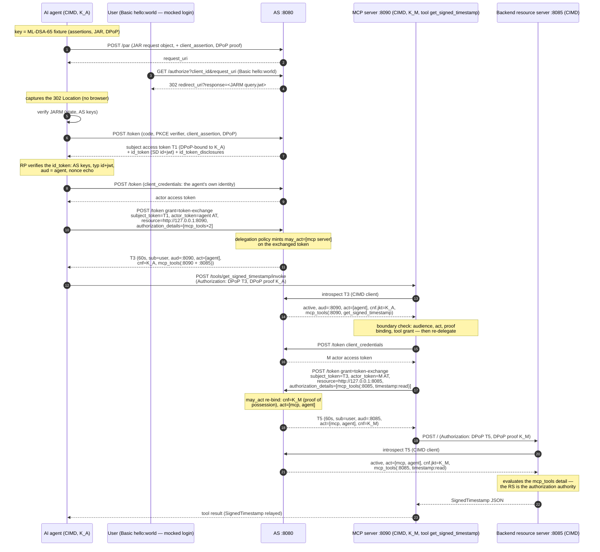

# AI-Agent Client (STS token exchange → MCP tool server → backend RS)

An AI agent acting on behalf of a user through a **delegation chain**: the
agent delegates to an MCP tool server (first RFC 8693 exchange), which
re-delegates to the backend resource server on the user's behalf (second
RFC 8693 exchange), relaying the signed timestamp back as the tool result.

The agent is a **Client ID Metadata Document** client
(draft-ietf-oauth-client-id-metadata-document) identified by the URL-shaped
`https://agent.example.org/ai-agent`, resolved by the example authorization
server through the CIMD fixture in
[`../authorizationserver/cimddemo`](../authorizationserver/cimddemo). The
MCP server (`https://mcp.example.org/server`) and the backend resource
server (`https://rs.example.org/timestamp`) are CIMD clients too — three
CIMD identities behind one AS allow-list.

Prerequisites: the example authorization server, the MCP tool server and
the resource server are running (see [`../README.md`](../README.md)):

```sh
go run ./examples/authorizationserver
go run ./examples/resourceserver
go run ./examples/mcpserver
```

Then:

```sh
go run ./examples/agentclient
```

## Flow



## Sample run (captured live)

```text
→ DPoP key thumbprint (dpop_jkt): b6iXAB0ebWk6jHvzqL6taNDAXGXidSuGMFhqCPB0alI
→ POST http://127.0.0.1:8080/par
← HTTP 201
← request_uri: urn:solid:…
→ user approval (mocked): GET /authorize with Basic hello:world
← HTTP 302
← authorization code (JARM verified, state matches): …
→ POST http://127.0.0.1:8080/token   (authorization_code + PKCE + DPoP)
← HTTP 200
← subject access token (token_type: DPoP)
← id_token (SD id+jwt, D-12.1): iss=http://127.0.0.1:8080 sub=… aud=https://agent.example.org/ai-agent nonce echoed
← disclosed user claims (from id_token_disclosures): email="hello@example.org" name="Hello World"
→ POST http://127.0.0.1:8080/token   (client_credentials: the agent's own identity)
← HTTP 200
← actor token (client_credentials): eyJhbGciOiJIUEtF…
→ POST http://127.0.0.1:8080/token
  grant_type=urn:ietf:params:oauth:grant-type:token-exchange
  subject_token=…  actor_token=…  resource=http://127.0.0.1:8090
  authorization_details=[{"type":"mcp_tools","locations":["http://127.0.0.1:8090"],"actions":["get_signed_timestamp"]} {"type":"mcp_tools","locations":["http://127.0.0.1:8085"],"actions":["timestamp:read"]}]
← HTTP 200
← delegated token T3 (token_type: DPoP, expires_in: 60s)
← authorization_details echoed (RFC 9396 §7): [{"type":"mcp_tools","locations":["http://127.0.0.1:8090"],"actions":["get_signed_timestamp"]} {"type":"mcp_tools","locations":["http://127.0.0.1:8085"],"actions":["timestamp:read"]}]
→ POST http://127.0.0.1:8090/tools/get_signed_timestamp/invoke
  Authorization: DPoP … + DPoP proof (K_A)
← HTTP 200
← tool result (signed timestamp, relayed through the MCP server):
  {"@context":"https://zntr.io/schemas/security/v1","@type":"SignedTimestamp","issuer":"http://localhost:8085", …}
→ POST http://127.0.0.1:8080/token   (negative probe: timestamp:write)
← HTTP 400
← negative probe rejected (RFC 9396 §6 subset): token endpoint error: invalid_authorization_details (…)
→ POST http://127.0.0.1:8080/token/introspect
← HTTP 200
← T3 introspection: client_id=https://agent.example.org/ai-agent status=TOKEN_STATUS_ACTIVE
←   act[0] = https://agent.example.org/ai-agent
```

Note: the PAR request object rides the form body (RFC 9126 §2.1), and
both `mcp_tools` entries are consented inside the request object so every
later subset request — the agent's hop-1 exchange and the MCP server's
hop-2 re-delegation — passes the RFC 9396 §6 check.

## What it exercises

* PAR (RFC 9126) with a JAR request object (RFC 9101), DPoP-proved
  (RFC 9449) and the `request_uri` consumption at `/authorize`.
* The mocked user approval leg: the Basic `hello:world` fixture stands in
  for the resource-owner login, the JARM `query.jwt` response (RFC 9447)
  is captured from the 302 Location.
* DPoP-bound `authorization_code` redemption with mandatory PKCE and nonce,
  plus retrieval and verification of the opt-in D-12.1 `id_token` (SD-JWT
  with Disclosures).
* **Per-call delegation** (RFC 8693): a fresh T3 is exchanged per tool
  call; the MCP server consumes it within its 60 s TTL.
* **may_act re-bind**: the AS delegation policy mints `may_act=[the MCP
  server]` on T3; the MCP server — authenticated through
  `private_key_jwt` (its CIMD key) — re-binds T5's `cnf` to its own DPoP
  proof key.
* **Chain act**: T5's act chain records `[mcp, agent]` — every hop of the
  delegation history survives transcription.
* **CIMD ×3**: the agent, the MCP server and the resource server are all
  Client ID Metadata Document clients behind the AS allow-list.
* RFC 9396 `authorization_details` across both hops: the subset rule is
  enforced at each exchange; a non-consented probe (`timestamp:write`)
  is rejected with `invalid_authorization_details`.
* RFC 7662 introspection at each boundary (HPKE phantom tokens —
  validation at the AS only, by design).

## The delegated re-binding posture

The second hop is authorized by a **policy gate, not a token capability**:
the AS delegation policy (wired in `examples/authorizationserver/main.go`)
is the only source of `may_act` listings, and a token whose subject did
not pass through an audience-restricted exchange toward the MCP resource
carries no `may_act` at all. A may_act-listed client proves *who it is*
through `private_key_jwt` client authentication (its CIMD signing key)
and *possession of its proof key* through the DPoP proof presented with
the exchange — the re-bound `cnf` is that proof's thumbprint. A stolen
subject token therefore fails even with the thief's own valid actor
token: not in `may_act` → strict path → no matching proof →
`invalid_grant`. The `act` chain and `may_act` listings are visible to
resource servers through introspection, keeping the delegation history
auditable end to end.

## Notes

* Both exchanged tokens live 60 seconds (RFC 8693 short-lived
  delegation): the demo runs sequentially, the tool call follows the
  hop-1 exchange immediately, and the MCP server's re-delegation follows
  the tool invocation.
* The agent's DPoP key binding survives the first exchange: the proof at
  the MCP boundary must use the same key the subject token was bound to
  (RFC 9449 section 8 — key swaps are rejected at the exchange).
* The client SDK decodes the introspection members (`sub`, `aud`, `act`)
  through their RFC 7662/8693 wire names.
