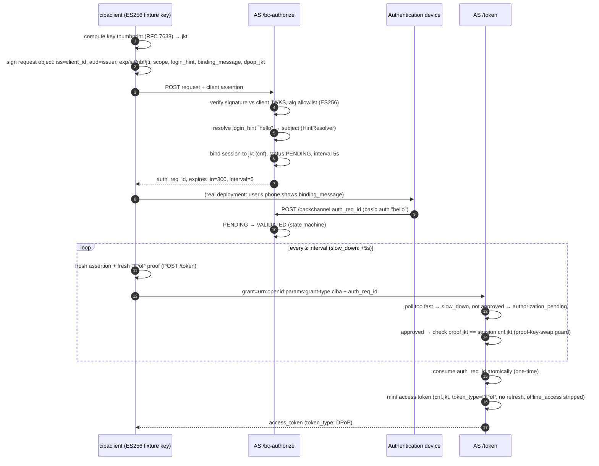

# CIBA Client (poll mode, DPoP-bound)

Drives the full OpenID CIBA Core 1.0 round trip in poll mode with a signed
request object and a DPoP key binding:

* client authentication with `private_key_jwt` (ES256, fresh assertion per
  request — each `jti` is single-use),
* all authentication request parameters — including the DPoP key
  thumbprint `dpop_jkt` — carried inside the signed request object
  (CIBA §7.1.1),
* end-user approval on the authentication device (the AS `/backchannel`
  endpoint standing in for the user's phone),
* token-endpoint polling with a fresh DPoP proof of the bound key per poll.

Prerequisite: `authorizationserver` running (see [`../README.md`](../README.md)).

## Flow



## Sample run (captured live)

```text
→ backchannel authentication endpoint: http://127.0.0.1:8080/bc-authorize
→ DPoP key thumbprint (dpop_jkt): eNCG3Vt7EWX2kdwDOsEhXg3N5r_L2QJGIQRQOqrdPtg
→ POST http://127.0.0.1:8080/bc-authorize
  Content-Type: application/x-www-form-urlencoded
  client_assertion=eyJhbGciOiJFUzI1NiIsInR5cCI6IkpXVCJ9.eyJhdWQiOiJ…(+260 bytes)
  client_assertion_type=urn:ietf:params:oauth:client-assertion-type:jwt-bearer
  request=eyJhbGciOiJFUzI1NiIsImtpZCI6ImVOQ0czVnQ3RVdYMmtk…(+566 bytes)
← HTTP 200
  "auth_req_id": "PjySnVSs1nF9vGOS53IeWJKnK63n1Prz"
  "expires_in": 300
  "interval": 5

← auth_req_id: PjySnVSs1nF9vGOS53IeWJKnK63n1Prz (expires_in: 300s, interval: 5s)
→ approving on the authentication device (binding_message: W4SCT)
→ POST http://127.0.0.1:8080/backchannel
  Authorization: Basic aGVsbG86d29ybGQ=
  Content-Type: application/x-www-form-urlencoded
  auth_req_id=PjySnVSs1nF9vGOS53IeWJKnK63n1Prz
← HTTP 200

→ POST http://127.0.0.1:8080/token
  Content-Type: application/x-www-form-urlencoded
  Dpop: eyJhbGciOiJFUzI1NiIsImp3ayI6eyJhbGciOiJFUzI1NiIs…(+493 bytes)
  auth_req_id=PjySnVSs1nF9vGOS53IeWJKnK63n1Prz
  client_assertion=eyJhbGciOiJFUzI1NiIsInR5cCI6IkpXVCJ9.eyJhdWQiOiJ…(+260 bytes)
  client_assertion_type=urn:ietf:params:oauth:client-assertion-type:jwt-bearer
  client_id=ciba-fixture-client
  grant_type=urn:openid:params:grant-type:ciba
← HTTP 200
  "access_token": "eyJhbGciOiJIUEtFLTciLCJraWQiOiJnLXZSSFdxdHVsb2J…(+6676 bytes)
  "expires_in": 3600
  "scope": "openid profile"
  "token_type": "DPoP"

← access_token: eyJhbGciOiJIUEtFLTci…
← token_type:   DPoP
← no refresh token, as designed (RFC 9700 §4.12.2)
```

## What it proves

* The solid promotion: `binding_message` is required (the CD/AD
  anti-phishing interlock) and charset-constrained.
* Signed request objects are verified against the client's registered
  JWKS with an EC-only algorithm allowlist; parameters may not appear
  outside the JWT.
* The optional DPoP binding (RFC 9449 §10 analog): polls without a proof or
  with the wrong key are rejected `invalid_grant` **before** the session is
  consumed — a retry with the right key still succeeds.
* The CIBA grant never mints refresh tokens and strips `offline_access`
  (RFC 9700 §4.12.2).
