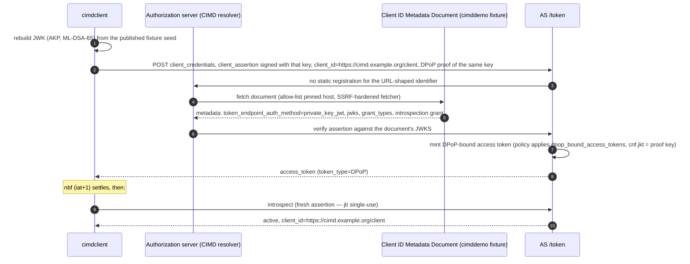

# CIMD Client (Client ID Metadata Document)

Demonstrates client authentication with a URL-shaped client identifier
resolved through its Client ID Metadata Document
(draft-ietf-oauth-client-id-metadata-document): the AS resolves
`https://cimd.example.org/client` to the demo fixture document at
authentication time — no static registration exists.

Prerequisite: `authorizationserver` running (see [`../README.md`](../README.md)).

## Flow



## Sample run (captured live)

```text
→ POST http://127.0.0.1:8080/token
  Content-Type: application/x-www-form-urlencoded
  Dpop: eyJhbGciOiJNTC1EU0EtNjUiLCJqd2siOnsiYWxnIjoiTUwt…(+8178 bytes)
  client_assertion=eyJhbGciOiJNTC1EU0EtNjUiLCJ0eXAiOiJKV1QifQ.eyJhd…(+4624 bytes)
  client_assertion_type=urn:ietf:params:oauth:client-assertion-type:jwt-bearer
  grant_type=client_credentials
  resource=http://127.0.0.1:8085
  scope=timestamp:read
← HTTP 200
  "access_token": "eyJhbGciOiJIUEtFLTciLCJraWQiOiJCQmJpc05ZazQ5dWF…(+6744 bytes)
  "expires_in": 3600
  "scope": "timestamp:read"
  "token_type": "DPoP"

→ POST http://127.0.0.1:8080/token/introspect
  Content-Type: application/x-www-form-urlencoded
  client_assertion=eyJhbGciOiJNTC1EU0EtNjUiLCJ0eXAiOiJKV1QifQ.eyJhd…(+4624 bytes)
  client_assertion_type=urn:ietf:params:oauth:client-assertion-type:jwt-bearer
  token=eyJhbGciOiJIUEtFLTciLCJraWQiOiJCQmJpc05ZazQ5dWFL…(+6742 bytes)
← HTTP 200
  "active": true
  "aud": "http://127.0.0.1:8085"
  "client_id": "https://cimd.example.org/client"
  "cnf": {"jkt":"w_R7vhhB_P_0d_3v32GOruCk5t4Ah_-IqJqgFrq2I48"}
  "exp": 1792004039
  "iat": 1792000439
  "iss": "http://127.0.0.1:8080"
  "jti": "HXjjAeOVpnTumHTz"
  "nbf": 1792000440
  "scope": "timestamp:read"
  "sub": "https://cimd.example.org/client"
  "token_type": "DPoP"

Introspection: client_id=https://cimd.example.org/client status=TOKEN_STATUS_ACTIVE
```

## What it proves

* Client registration moves to the document: the AS trust decision is
  reduced to a host allow-list (operator-pinned, never caller-controlled)
  and the SSRF-hardened fetch.
* The document's grants flow through: the introspection call succeeds
  because the *document* declares `authorized_introspection_clients`.
* The operator policy binds the resolved client to DPoP
  (`dpop_bound_access_tokens=true` applied over the fetched document): the
  token request carries a DPoP proof of the client key, the minted token is
  sender-constrained (`token_type=DPoP`, introspection surfaces `cnf.jkt`).
* Assertions stay single-use (`jti` burned per request), so the demo mints
  a fresh one before introspecting.
