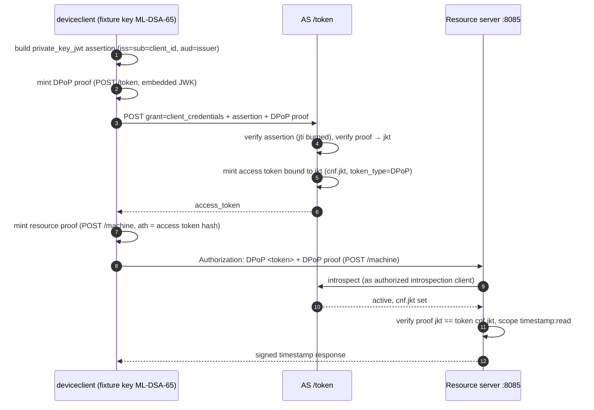

# Device Client (DPoP-bound client_credentials)

Despite the name inherited from the device ecosystem, this demo exercises a
`client_credentials` grant whose access tokens must be DPoP-bound
(`DpopBoundAccessTokens` on the fixture client), then calls the timestamp
resource with a fresh proof carrying the token value.

Prerequisite: `authorizationserver` and `resourceserver` running
(see [`../README.md`](../README.md)).

## Flow



## Sample run (captured live)

Discovery, the DPoP-proved token request, and the resource call — token,
proof, and assertion values truncated by the flow logger:

```text
→ GET http://127.0.0.1:8080/.well-known/oauth-authorization-server
← HTTP 200
→ GET http://127.0.0.1:8080/keys
← HTTP 200
→ POST http://127.0.0.1:8080/token
  Content-Type: application/x-www-form-urlencoded
  Dpop: eyJhbGciOiJNTC1EU0EtNjUiLCJqd2siOnsiYWxnIjoiTUwt…(+8196 bytes)
  client_assertion=eyJhbGciOiJNTC1EU0EtNjUiLCJ0eXAiOiJKV1QifQ.eyJhd…(+4627 bytes)
  client_assertion_type=urn:ietf:params:oauth:client-assertion-type:jwt-bearer
  grant_type=client_credentials
  resource=http://127.0.0.1:8085
  scope=timestamp:read
← HTTP 200
  "access_token": "eyJhbGciOiJIUEtFLTciLCJraWQiOiJnLXZSSFdxdHVsb2J…(+6760 bytes)
  "expires_in": 3600
  "scope": "timestamp:read"
  "token_type": "DPoP"

→ POST http://127.0.0.1:8085/machine
  Authorization: DPoP eyJhbGciOiJIUEtFLTciLCJraWQiOiJnLXZSSFdxd…(+6763 bytes)
  Dpop: eyJhbGciOiJNTC1EU0EtNjUiLCJqd2siOnsiYWxnIjoiTUwt…(+8259 bytes)
← HTTP 200
  SignedTimestamp JSON (issuer, timestamp, signature)
```

The `/machine` surface carries the same audience/scope/DPoP enforcement as
`/` but no end-user ACR requirement (RFC 9470 step-up on `/` applies to
end-user tokens; a `client_credentials` token carries no login event).

## What it proves

* Client authentication is asymmetric only (`private_key_jwt`,
  ML-DSA-65): no secrets over the wire.
* DPoP sender-constrains both the minted token (proof at the token
  endpoint) and its use (fresh proof with `ath` at the resource).
* The resource server refuses bearer use of a DPoP-bound token
  (`cnf.jkt` set → proof required).
