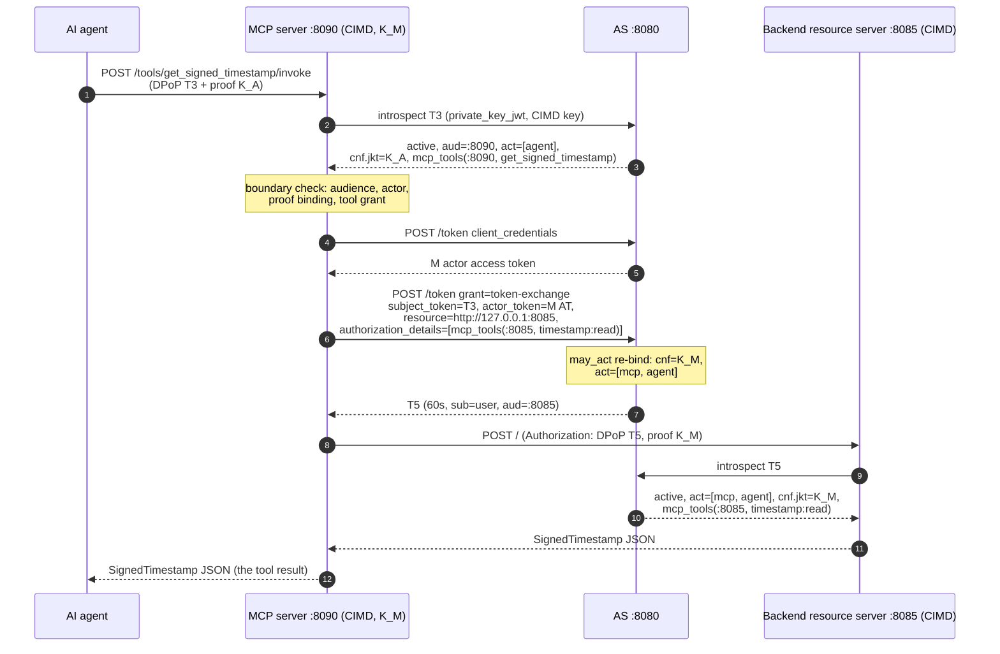

# MCP Tool Server (delegated re-delegation, user on-behalf-of)

A small MCP-style tool server standing between an AI agent and a backend
resource server: it exposes one tool — `get_signed_timestamp` — and
re-delegates the agent's token (RFC 8693, `may_act`-authorized) to call the
backend [`../resourceserver`](../resourceserver) on behalf of the user,
relaying the signed timestamp as the tool result.

The server is a **Client ID Metadata Document** client
(draft-ietf-oauth-client-id-metadata-document) identified by the URL-shaped
`https://mcp.example.org/server`, resolved by the example authorization
server through the CIMD fixture in
[`../authorizationserver/cimddemo`](../authorizationserver/cimddemo). Its
document authorizes `client_credentials` (its actor token) and
`urn:ietf:params:oauth:grant-type:token-exchange` (the second hop), and
authorizes the backend resource server to introspect the tokens it mints
(`authorized_introspection_clients`, RFC 7662 section 2.1).

Prerequisites: the example authorization server and resource server are
running (see [`../README.md`](../README.md)):

```sh
go run ./examples/authorizationserver
go run ./examples/resourceserver
```

Then:

```sh
go run ./examples/mcpserver
```

## Endpoints

|Path|Role|
|---|---|
|`GET /.well-known/oauth-protected-resource`|RFC 9728 metadata: the resource indicator `http://127.0.0.1:8090`, the authorization server behind it|
|`POST /tools/get_signed_timestamp/invoke`|The tool: requires `Authorization: DPoP <T3>` + a `DPoP` proof|

## Flow (per tool invocation)



Error surface: backend failures answer `502` with a JSON
`{"error":"tool_execution_failed"}` envelope; authentication failures at
the MCP boundary answer `401` with a `WWW-Authenticate: DPoP` challenge
carrying the RFC 9728 `resource`/`resource_metadata` pointers.

## Boundary checks (per tool invocation)

The MCP server is the authorization authority for the tool (RFC 9396
section 5: the resource server evaluates the details):

* RFC 7662 introspection — the AS mints HPKE-encrypted phantom tokens,
  local verification is impossible by design;
* RFC 8707 audience: `aud` must be `http://127.0.0.1:8090`;
* RFC 9449 proof binding: the DPoP proof thumbprint must equal the
  token's `cnf.jkt` (the agent's key);
* RFC 8693 act chain: the immediate actor must be the agent client;
* RFC 9396 tool grant: the token must carry
  `mcp_tools(:8090, get_signed_timestamp)`.

## Notes

* The tool server's fixture key (`cimddemo.McpServerClientSeedB64`)
  drives both its client assertions and its DPoP proofs: possession of
  that key is what the `may_act` re-bind accepts.
* The re-delegation must complete within T3's 60 s TTL — the tool handler
  runs the second hop synchronously, immediately after the boundary
  checks.
