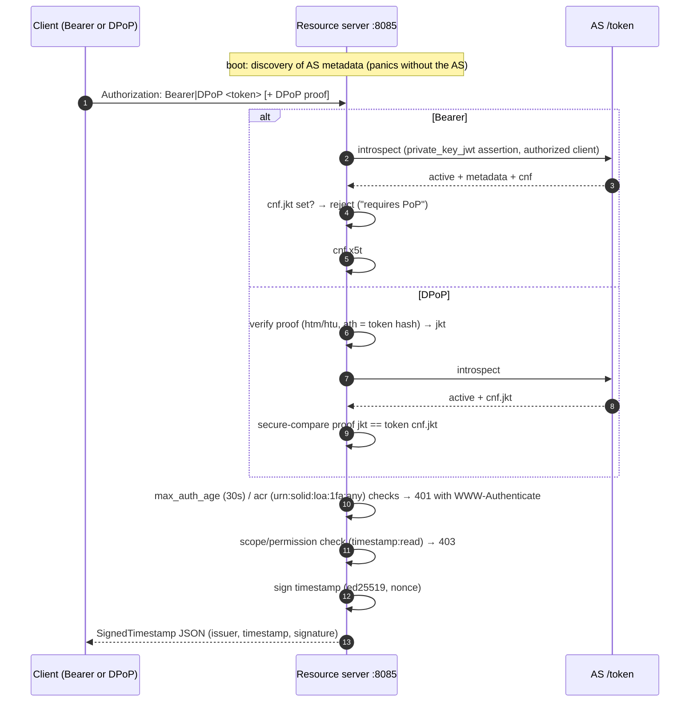

# Resource Server (signed timestamp)

Protected resource serving a signed timestamp. It is a reference consumer
of the solid stack: discovery of the AS, token introspection under the
`authorized_introspection_clients` grant, Bearer and DPoP access, RFC 8705
certificate binding, RFC 9470 step-up signals (`max_age`, `acr`), and
RFC 9396 `authorization_details` evaluation for MCP-style tool access
(the `agentclient` demo exchanges a token carrying an `mcp_tools` detail;
this resource server — not the AS — makes the authorization decision on
the carried entries).

Prerequisites: `authorizationserver` running (see [`../README.md`](../README.md)).
The `agentclient` demo additionally requires this server (it is the target
resource of the token exchange).

## Endpoints

* `/.well-known/oauth-protected-resource` — PRM (RFC 9728)
* `/` — the signed-timestamp resource (scope `timestamp:read`)

## Flow

## What it proves

* A resource server can authorize on both proof schemes with the same
  middleware (`Bearer` and `DPoP` schemes dispatched on the
  `Authorization` prefix).
* Sender-constrained tokens are enforced, not just introspected: a
  DPoP-bound token fails Bearer access; a certificate-bound token fails
  without the bound mTLS certificate.
* Step-up authentication challenges carry the RFC 9470 fields
  (`max_age`, `acr_values`) and RFC 9728 discovery pointers
  (`resource`, `resource_metadata`).
* RFC 9396 authorization_details arriving through a token-exchange
  delegation (RFC 8693) are evaluated here: the AI-agent client
  (`https://agent.example.org/ai-agent`, see `agentclient`) only reaches
  the `timestamp:read` intent when its exchanged token carries the
  matching `mcp_tools` detail for this resource. The AS transports the
  entries (mocked processing); this resource server is the authorization
  authority for MCP tool access.
