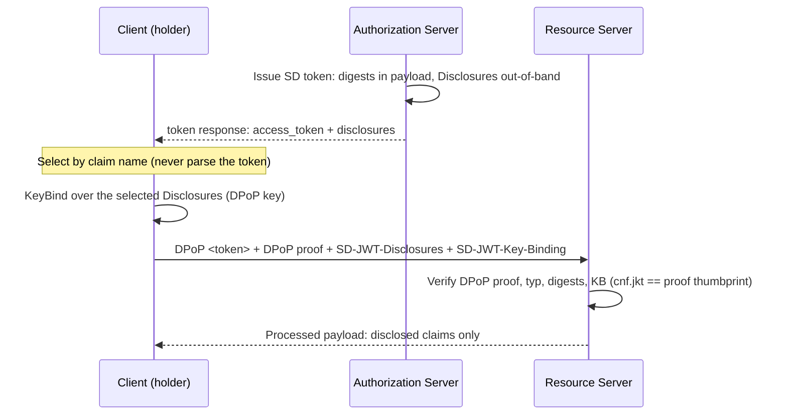

# Selectively Disclosable Tokens (`examples/sdtoken`)

Reference assembly of **draft-forten-oauth-sd-jwt-access-token-00** —
"Selective Disclosure for JWT Access Tokens Without Changing the Token" —
plus the SDK-level **ID-token generalization** of the same profile, over both
serializations (JWT per the draft, CWT as the format-agnostic analog).

## What it demonstrates

- **Access tokens whose non-protocol claims are selectively disclosable**
  (RFC 9901 semantics): the token keeps its ordinary `typ` (`at+jwt`, or
  `application/at+cwt` on the CWT side) and carries only digests (`_sd` +
  `_sd_alg`, or `redacted_claim_keys` + `sd_alg`); the Disclosures travel in
  the token response `disclosures` parameter.
- **Per-request presentation**: the client selects Disclosures by claim name
  (it never parses the token — draft §4) and sends them in the
  `SD-JWT-Disclosures` HTTP field (RFC 9651 Structured Fields List of
  Strings), with the key-binding JWT in `SD-JWT-Key-Binding`.
- **DPoP-bound key binding**: the KB is signed by the client's DPoP proof
  key; the verifier enforces the draft §5.3 thumbprint equality
  (`cnf.jkt` == SHA-256 thumbprint of the proof key).
- **SD ID tokens** (the generalization): OIDC-core claims protected, user
  claims (`email`, `name`) disclosable, verified by the client with the
  `id_token` profile (`typ` `id+jwt` / `application/id+cwt`). Example-level
  direct mint — the reference AS (`examples/authorizationserver`) mints them
  opt-in via the D-12.1 `WithIDTokenGenerator` wiring; this example shows the
  direct-mint form.
- **Both serializations** through one profile factory: `--format=cwt` runs
  the identical flow over the CWT kind.



## Sample run (captured live)

```text
== access token (DPoP-bound, cnf.jkt = n5fNflpxW0ks...) ==
RS-verified processed payload: email=alice@example.com name=<nil>

== id token (profile generalization, typ id+jwt / application/id+cwt) ==
client-verified claims: nonce=n-0S6_WzA2Mj auth_time=1.791881307e+09 email=alice@example.com name=<nil>

== raw token payloads (digests only) ==
  JWT payload: {
    "_sd": [
      "OuvzPY2nCCtVmG5h98Mu0HR-DKnl77KBpfxjb5Goka8",
      "elsqQx0mx21n4pFh5Qcg0jGm3zykLtUmF8QTNd1gdKg"
    ],
    "_sd_alg": "sha-256",
    "aud": "https://rs.example.com",
    "cnf": { "jkt": "n5fNflpxW0ksfQ01OWKlI-RAcrrpVBkyEtx3MR-tT6s" },
    "exp": 1791884937, "iat": 1791881337,
    "iss": "https://as.example.com", "jti": "at-raw-1", "sub": "user-42"
  }

flow verified end-to-end: digests in the token, values only in the disclosures.
```

The holder disclosed `email` and withheld `name` — the RS-verified payload
shows only the disclosed claim.

## Running

```sh
go run ./examples/sdtoken            # JWT serialization (the draft form)
go run ./examples/sdtoken --format=cwt
```

The run prints the RS-verified processed payload (disclosed `email`,
withheld `name`), the verified SD ID token claims, and the raw token
payload showing digests and no cleartext user claims — the smoke test of
the mechanism.

## Where the pieces live

|Piece|Location|
|---|---|
|Profile contracts, kind factory, structured fields|`sdk/sdtoken`|
|JWT adapter (draft-forten serialization)|`sdk/sdtoken/sdjwt`|
|CWT adapter (SD-CWT shape)|`sdk/sdtoken/sdcwt`|
|Token generators (mutation-and-persist of `tokenv1.Token`)|`sdk/token/sd`|
|Token response `disclosures` parameter|`server/httpkit`|
|Vendored draft|`docs/rfcs/draft-forten-oauth-sd-jwt-access-token-00.txt`|
